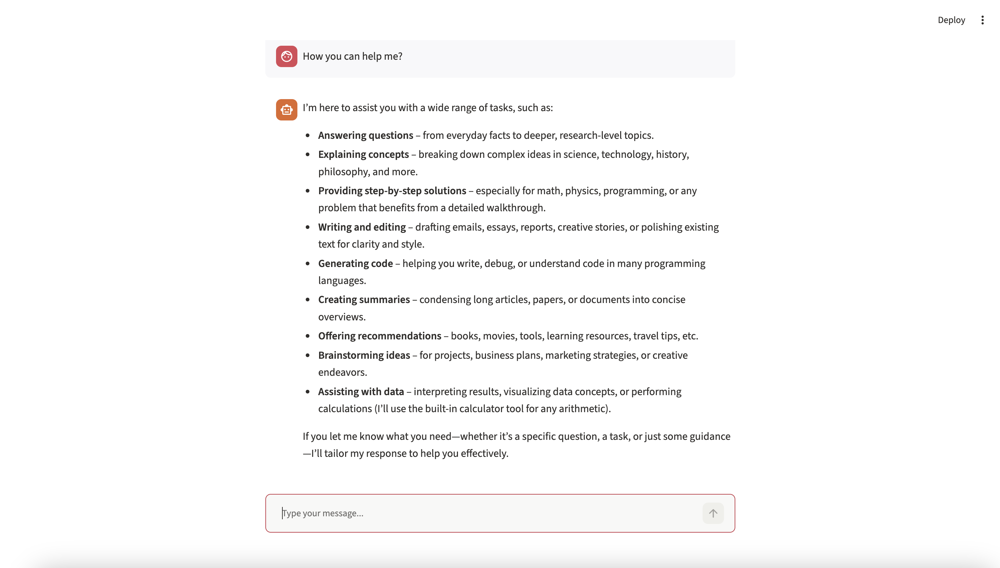

# 🤖 AI Agent with Tools

A simple AI agent that chats with you and decides on its own when to use a tool.

Built with **LangChain**, **LangGraph**, **Groq** and **Streamlit**.



## Features

- Chat interface that remembers the conversation
- The agent decides when to call a tool
- One custom tool: `calculator`

## Run it

```bash
cp .env.example .env    # add your Groq API key
uv sync
uv run streamlit run app.py
```

## Next steps

- [ ] Add more tools
- [ ] Save data in a database
